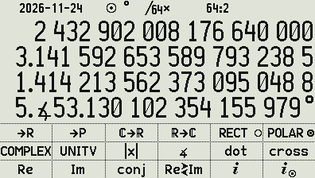
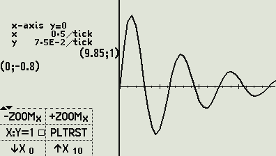
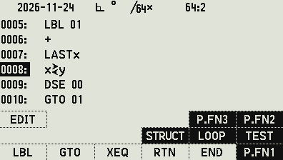

# c47-cg

A port of the [C47](https://gitlab.com/rpncalculators/c43) RPN calculator firmware, in its R47
form, to the Casio fx-CG50 as a gint add-in.

It is the complete C47 firmware: every function of the R47 (34-digit maths, exact big
integers, complex numbers, matrices, statistics, the solver, equations and graphs, keystroke
programming), its menus and its fonts, with your state kept across MENU and switching off, and
states, programs and data saved and loaded from the I/O menu. The releases are marked
pre-release (0.x) while it gets tried on more calculators, and follow upstream C47 closely
(see Installing).

## Screenshots

On the CG50's own OS (3.60, in an emulator), with C47's own fonts:

The stack after a few calculations: 20! as an exact integer, π and √2 to 34 digits, 3+4i in
polar form, and the complex-number menu.

A damped oscillation, y = sin(2x)·e^(−x/4), typed in C47's equation editor and graphed.

Keying in a program: the loop of an iterative Fibonacci (`LBL 'FIB' … LBL 01 + LASTx x⇄y DSE 00
GTO 01 … RTN`; 10 XEQ FIB gives 55).

The key scripts that make them are `tests/readme_*.txt` (for the PC test build and, through
`tests/emu_keys.py`, the emulator).

## How it works

- **Upstream C47, unchanged except for patches.** `tools/sync_upstream.py` fetches the commit
  pinned in `UPSTREAM` into `upstream/`, applies `patches/*.patch`, and runs upstream's own
  generators (fonts, constants, catalogs). The fonts are the R47's, generated from upstream's
  TrueType files by upstream's tool.
- **The CG50 is big-endian,** the R47 little-endian: the generated constants table is
  byte-swapped by the sync script and decNumber is built with `DECLITEND=0`.
- **A DMCP layer** (`src/dmcp_*.c`): C47 is built as for the R47 hardware (`DMCP_BUILD`,
  `NEW_HW`, R47 keyboard) and calls SwissMicros's DMCP system functions; these implement
  them: the 400x240 one-bit screen buffer, the key buffer, sleep and timers, the clock, and
  FatFs-style files on the storage memory (in `\\fls0\C47\`).
- **The screen:** `patches/0001-layout-396x224.patch` lays C47 out for the CG50's 396x224:
  status bar and softkey rows as on the R47, stack lines 32 px instead of 36, full-screen
  views fitted.
- **The platform** (`src/plat.h`): `src/plat_gint.c` on the calculator, `src/plat_host.c` for a
  PC test build that runs a key script on a simulated clock and writes screenshots.
- **Big integers:** GMP's mini-gmp (`src/gmp/`) with the three functions C47 needs that it
  lacks.

- **fxlibc fixes** (`src/compat/`): headers the calculator's C library lacks (`libgen.h`,
  `sys/time.h`, `stpcpy`), and standard `strchr` / `strrchr` / `strchrnul` in place of
  fxlibc 1.5.1's, which never find the terminating null and miss bytes >= 0x80.

Keys: [docs/KEYS.md](docs/KEYS.md).

## Installing

Download `C47.g3a` from the [Releases](https://github.com/fxprgm/c47-cg/releases) page (built by
GitHub from main after each sync with upstream C47; pre-releases while below 1.0), copy it to
the calculator's storage memory (USB, as any add-in), and start C47 from the
main menu. C47 keeps its files in the folder `\C47` there, and saves its state there when you
press MENU or switch off, so it is as you left it next time.

## Limitations

- The CG50 has no buzzer and no IR printer: BEEP/TONE and printing do nothing.
- SNAP (screenshots) doesn't save anything yet.
- The screen is 4 pixels narrower than the R47's: a few numbers that just fit on the R47 are
  shown in scientific notation (see Testing).
- Tried on fx-CG50 calculators so far, and tested at length in an emulator running the CG50's
  own OS. The Graph 90+E is the same hardware and should work too; reports welcome.

## Testing

- **Upstream's own test suite on a big-endian CPU:** `python3 tools/test_bigendian.py --arch ppc`
  builds upstream's `src/testSuite` (91,019 tests) natively and for 32-bit big-endian PowerPC,
  runs it under qemu-user, and compares the two (setup at the top of the script).
  `patches/0002-big-endian-byte-order.patch` holds what it found (and `0003` keeps the test
  suite's screen buffer at 400x240 under the layout patch): program literals, the
  state file's program words and `testPgms.bin` kept in the little-endian byte order C47's
  files have, so files move between the CG50 and other C47 calculators; SEED gives the same
  random sequence on any CPU. With it, big-endian and little-endian fail exactly the same
  tests.
- **Those that fail on both, by design:** 1,871 tests expect the R47's 400-pixel width. With
  396 pixels a few numbers no longer fit and are shown in scientific notation (1,856 tests in
  `drm_longint_cov.txt`, e.g. a 21-digit negative integer), and screenshot hashes change
  (15 in `graphs_cov.txt` and `nested_cov.txt`). Without the layout patch all 91,019 pass.
- **The add-in's own code** (`src/`) runs in the PC test build with key scripts
  (`tests/*.txt`; `tests/run_layout.py` runs the layout ones).
- **The add-in itself** is run in an fx-CG50 emulator on the calculator's real OS (from the
  [casio-cg50](https://github.com/hexbinoct/casio-cg50) project, `emu_go/c47_probe_test.go`):
  keys, menus, complex numbers, MENU and back, restarts, manual save and load.

## Building

Needs, on the build machine: the fxSDK with gint (built with fxSDK 2.11, gint 2.11, fxlibc
1.5.1, GCC 14.1, installed with [GiteaPC](https://git.planet-casio.com/Lephenixnoir/giteapc));
Python 3, meson, ninja, a C compiler, freetype2, gmp, gtk+-3.0 (upstream's meson.build wants
it even for the generators) and [xlsxio](https://github.com/brechtsanders/xlsxio)'s
`xlsxio_xlsx2csv`.

    python tools/sync_upstream.py         # upstream + patches + generated sources
    fxsdk build-cg                        # the add-in, C47.g3a (fxSDK + gint)
    python tools/build_host.py --mini-gmp # the PC test build, build/c47cg_host_mini
    build/c47cg_host_mini tests/smoke.txt # run a key script, write screenshots

## License

GPL-3.0, as the upstream firmware. `src/dmcp/` holds SwissMicros's DMCP SDK headers
(BSD-3-Clause, adapted); `src/gmp/mini-gmp.*` is from GMP (LGPLv3 / GPLv2+).

This is an independent community project, not affiliated with SwissMicros or Casio.
